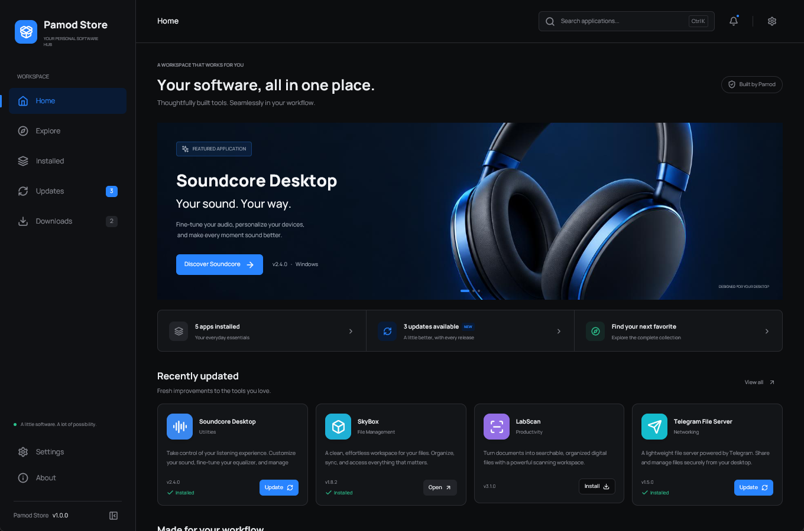

# XD

A personal app-store desktop client for Windows, built with **Rust** and **[GPUI](https://www.gpui.rs)** (no webview), styled to match its reference design pixel-for-pixel.



## Features

- **Home** — hero, featured app, quick stats, recently updated and curated app grids
- **Explore** — search, category filters, sorting, grid/list views
- **Installed / Updates** — manage installed apps, update queue, ignore updates
- **Downloads** — download queue with statuses and clear-completed
- **App details** — overview, screenshots, release notes, repo links, install/update/uninstall
- **Settings** — appearance (theme/density), download directory, concurrent downloads, behavior toggles
- **Command palette** — `Ctrl/Cmd+K` to search apps or jump to a page
- **Toasts & confirmations** for install/update/uninstall flows

## Tech stack

| Layer    | Choice                              |
| -------- | ----------------------------------- |
| UI       | GPUI 0.2.2 (Zed's UI framework)     |
| Language | Rust 2021 edition                   |
| Fonts    | Manrope (variable TTF, bundled)     |
| Icons    | Inline SVG set (`assets/icons/`)    |
| Data     | In-memory catalog + JSON preferences |

## Build & run

```powershell
cargo run --release
```

Requirements: Rust 1.98+ (tested), Windows 10/11. The window opens at 1360×900.

For day-to-day development:

```powershell
cargo build
.\target\debug\xd-store.exe
```

## Project layout

```
assets/            fonts, icons, hero artwork
src/
  main.rs          entry point, window, fonts, asset source
  shell.rs         window chrome: titlebar, sidebar, header, routing, dialogs
  ui.rs            primitives: buttons, inputs, selects, section headings
  components.rs    app cards, badges, icon tiles
  pages/           home, explore (+installed), details, updates, downloads, settings, about
  state.rs         StoreState: navigation, inputs, toasts, dispatch
  data.rs          catalog, actions, filters, update logic
  theme.rs         palette (dark/light), density, color helpers
  icons.rs         SVG icon loader
```

## Preferences

Settings are persisted as JSON under `%APPDATA%\XD\preferences.json` and reloaded on startup.

## License

Personal project — all rights reserved.
